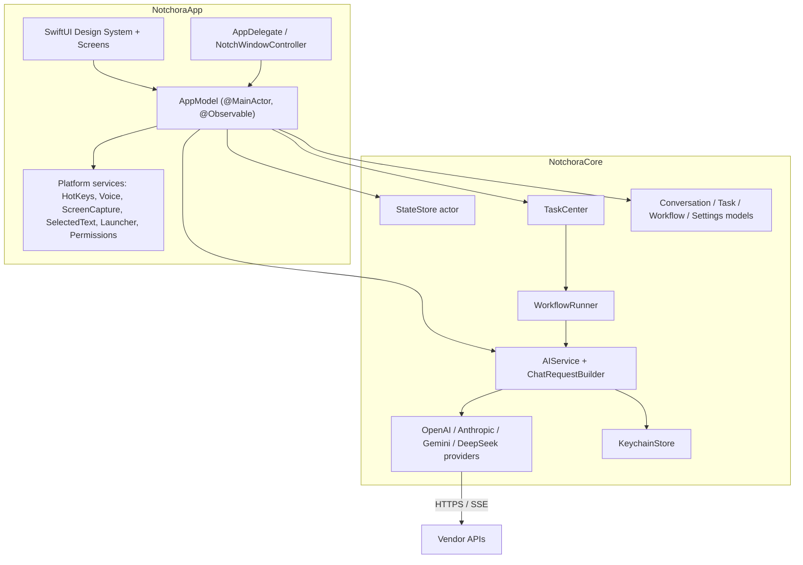
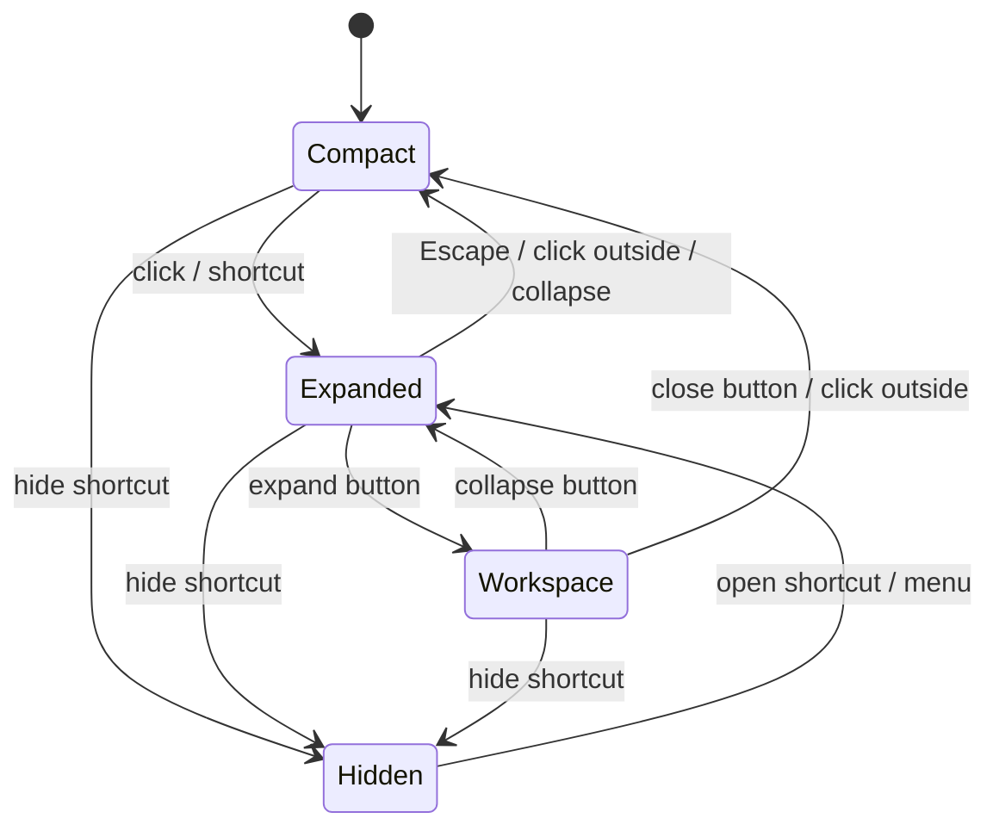

# NOTCHORA Architecture

## 1. Shape of the system

NOTCHORA is a Swift Package with two targets and one XCTest target:

| Target | Path | Responsibility |
|---|---|---|
| `NotchoraCore` | `Sources/NotchoraCore` | Domain models, provider wire formats, SSE, persistence, Keychain abstraction, task center, workflow engine, search, settings, utilities |
| `NotchoraApp` | `Sources/NotchoraApp` | App lifecycle, AppKit windows, SwiftUI design system and screens, global hotkeys, permissions, voice, screen capture, app launcher |
| `NotchoraCoreTests` | `Tests/NotchoraCoreTests` | 58 unit tests with injected transport/service/keychain doubles |

There are no external package dependencies.



## 2. UI and lifecycle

### App entry

`NotchoraApp` is a SwiftUI `App` with an empty `Settings` scene and a custom `NSApplicationDelegate`. Cmd+, and the app-menu Settings item are routed into the notch workspace; there is no separate settings window.

`AppDelegate` owns:

- the notch window controller;
- the status bar controller;
- the Carbon global hotkey manager;
- the application termination flush.

The app is an accessory app (`LSUIElement = true`). There is no Dock icon and no normal document window.

### Notch window

`NotchWindowController` creates a borderless `NSPanel` subclass with:

- `.nonactivatingPanel` style;
- `.statusBar` level;
- `canJoinAllSpaces`, `fullScreenAuxiliary`, `stationary`, `ignoresCycle`;
- a clear window background, no titlebar, no shadow, and no window background blur;
- a SwiftUI `NSHostingView` as content.

The panel is only a transparent container. Inside it, `NotchRootView` renders the notch surface as one SwiftUI shape with an opaque `Color.black` fill. The shape's top edge is pinned to the display edge; its width and height animate from the compact notch size to the expanded/workspace size. Only the rounded area outside the shape is transparent. There is no second window and no material or border around the surface.

`NotchGeometry` chooses the target `NSScreen` from the display preference and computes:

- physical notch width using `auxiliaryTopLeftArea` / `auxiliaryTopRightArea`;
- top rail height using `safeAreaInsets.top`;
- compact, expanded, and workspace surface sizes;
- the window container frame used while the shape animates.

On notched displays the compact surface is exactly the measured hardware notch rectangle (width and safe-area height), with the same black fill and a 8 pt lower-corner radius. It adds no clickable ears or chin. On displays without a notch, a compact black pill is positioned just below the menu bar with rounded top and bottom corners.

Expansion saves the previously frontmost app, activates NOTCHORA so text fields and VoiceOver are reliable, and restores the previous app on collapse only when NOTCHORA is still frontmost. This avoids focus theft while keeping the panel usable.

### Presentation state machine



While compact, a pointer-position monitor widens the visible surface by 28 pt as a hit-target preview; it never opens by hover, and a click opens the panel.

The window container is enlarged immediately when the surface needs room and trimmed back only after the spring has settled. The visible black shape itself is animated by SwiftUI from separate width and height states: width springs first, then height settles, so it stretches sideways out of the cutout before descending. Content is faded in after the growth starts, and the compact content is hidden while the shape collapses. This avoids a resized-window flash, a rectangular snapshot, or a separate panel appearing under the notch.

`Reduce Motion` and the in-app animation setting disable the surface spring; the shape changes size immediately.

The hosting view is rebuilt when the global appearance changes, but the notch surface itself is always forced to dark, opaque black. The appearance preference still controls system menus and AppKit controls; it never makes the notch translucent or light.

## 3. State and business logic

`AppModel` is a `@MainActor @Observable` class holding:

- conversations and selection;
- active route and panel presentation;
- workflows and launcher entries;
- Multi-AI session state;
- task center and voice session references;
- toast/UI transient state;
- service dependencies.

It is split across focused extensions:

| File | Responsibility |
|---|---|
| `AppModel.swift` | state, navigation, conversation CRUD, toasts, callbacks |
| `AppModel+Lifecycle.swift` | bootstrap, sanitize recovered chats, save/debounce, data deletion |
| `AppModel+Chat.swift` | send/stream/cancel/regenerate, model and system prompt |
| `AppModel+MultiAI.swift` | parallel target runs, compare, save results |
| `AppModel+Handoff.swift` | summary generation, draft creation, auto-continuation |
| `AppModel+Workflows.swift` | workflow CRUD, run events, task progress, result conversation |
| `AppModel+Context.swift` | selected text, clipboard, screenshot, permissions |
| `AppModel+Voice.swift` | voice session UI state and voice chat generation |
| `AppModel+ProvidersApps.swift` | provider key/model management, launcher, launch at login |
| `AppModel+Shortcuts.swift` | global shortcut actions |

This keeps the SwiftUI views declarative and prevents platform integration from leaking into the domain layer.

## 4. AI providers

`AIProvider` is the boundary:

```swift
protocol AIProvider: Sendable {
    var id: AIProviderID { get }
    var capabilities: ProviderCapabilities { get }
    func stream(request: AIRequest, apiKey: String) async throws -> AsyncThrowingStream<AIStreamEvent, Error>
    func validateKey(_ apiKey: String) async throws
    func listModels(apiKey: String) async throws -> [AIModel]
}
```

`ProviderRegistry` maps IDs to implementations. `AIService` owns Keychain lookup and exposes only high-level operations to the app:

- `stream(_:)`
- `complete(_:)` for workflows, summaries, and comparisons
- `validateKey(_:for:)`
- `listModels(for:)` / `listModels(for:apiKey:)`

### Wire formats

Each provider has its own request and response decoding:

| Provider | Endpoint | Streaming format |
|---|---|---|
| OpenAI | `POST /v1/chat/completions` | SSE `choices[].delta.content`; `usage` |
| Anthropic | `POST /v1/messages` | Named SSE events (`message_start`, `content_block_delta`, `message_delta`, …) |
| Gemini | `POST /v1beta/models/{model}:streamGenerateContent?alt=sse` | SSE `candidates[].content.parts[].text`; `usageMetadata` |
| DeepSeek | `POST /chat/completions` | OpenAI-compatible SSE `choices[].delta.content`; `max_tokens`; reasoning deltas ignored |

Request builders handle provider-specific differences:

- system prompt placement;
- vision payload shapes (`image_url`, `image` blocks, `inlineData`);
- max token field names;
- role names (`assistant` vs `model`);
- temperature support for reasoning models;
- auth headers (`Bearer`, `x-api-key`, `x-goog-api-key`).

### SSE and cancellation

`SSEParser` is an incremental frame parser. It supports multi-line `data:` fields, event names, comments, CRLF input, and `[DONE]`.

`ProviderStreamSupport` wraps a request in an `AsyncThrowingStream<AIStreamEvent, Error>`:

- establishes the HTTP connection before yielding `.started`;
- applies `RetryPolicy` to retryable connection/status failures;
- maps transport and HTTP errors into `AIProviderError`;
- yields `.usage` and `.completed`;
- cancels the producing `Task` when the stream terminates.

`AIService.complete` aggregates deltas and rejects empty responses. The app can cancel a stream at any point; partial text is preserved and marked cancelled.

### Model catalog

`ModelCatalog` merges:

1. curated model suggestions;
2. provider-discovered models;
3. user-added custom IDs.

Discovered lists are persisted and replace curated lists for that provider after a successful refresh. The app never assumes a static model set.

## 5. Chat and generation lifecycle

1. `ChatRequestBuilder` filters empty/failed turns, merges adjacent same-role turns, checks vision capability, and creates provider-neutral messages.
2. `AppModel` appends the user message and an empty streaming assistant message.
3. A task is registered with `TaskCenter`.
4. `AIService.stream` loads the key from Keychain and asks the provider for a stream.
5. Deltas are coalesced through `RenderThrottle` (≈22 fps) before mutating SwiftUI state, then a final full text update is written on completion.
6. Usage, duration, status, and error are persisted.
7. The task transitions to completed/failed/cancelled.

A conversation can have independent generation tasks, but only one active stream per conversation. Closing the panel does not cancel generation; users can continue working elsewhere. Quitting the process ends in-process tasks; on next launch, any task that was still running is marked cancelled with a visible explanation.

## 6. Multi-AI, compare, and handoff

### Multi-AI

`AppModel.startMultiAI` creates one `Task` and one `TaskCenter` entry per selected model. Each target has independent:

- status;
- streamed text;
- token usage;
- cancellation handle;
- retry action.

The UI uses `LazyVGrid` with adaptive columns: one column in the compact expanded panel, two or more in the full workspace. Results can be saved into a single history conversation, with one assistant message per model.

### Compare Answers

`CompareRequestBuilder` produces a single request containing labeled responses and explicit instructions to:

- identify contradictions;
- point out likely errors and unsupported claims;
- compare argument quality and strengths;
- synthesize while preserving genuine disagreement.

The UI and request both state that this is model-generated analysis, not objective fact-checking.

### Handoff

`HandoffBuilder` supports:

- full transcript;
- selected messages;
- an AI-generated summary;
- editable context before sending;
- target model selection.

The receiving model gets a system instruction explaining that the transcript is untrusted context and that it should not claim authorship of earlier messages. The app can auto-continue with one request after handoff.

## 7. Tasks and workflow engine

`TaskCenter` is a `@MainActor @Observable` task list with cancellation handles. It never invents a progress percentage. Running rows use an indeterminate animation.

`WorkflowRunner` is a `@MainActor` service that executes steps sequentially:

- step input is original request, previous output, or a composed report of all previous outputs;
- `{{input}}` substitution is explicit;
- each step makes a real provider call via `AIService.complete`;
- failures stop the run and surface the failing step;
- completion produces a saved conversation with one assistant message per step.

The workflow editor is a native SwiftUI form with add/remove/reorder, provider/model menus, input source selection, prompt templates, and optional system prompts.

## 8. Persistence

`StateStore` is an actor that writes an atomic JSON snapshot to:

```text
~/Library/Application Support/NOTCHORA/state.json
```

Schema:

```text
PersistedState
├── schemaVersion
├── conversations[]
│   ├── id, title, provider, model, systemPrompt
│   └── messages[] (role, content, status, usage, attachments)
├── tasks[]
├── workflows[]
├── launcherEntries[]
├── lastConversationID
└── savedAt
```

- Directory mode: `0700`.
- File mode: `0600`.
- Writes are atomic.
- Corrupt files are quarantined as `state.corrupt-<timestamp>.json` instead of being silently discarded.
- Unsupported future schema versions fail with a clear error.
- API keys are deliberately absent from this model.

Saving is debounced while streaming and flushed on normal termination via `applicationShouldTerminate`.

## 9. Keychain and secrets

`SystemKeychainStore` uses `kSecClassGenericPassword` with:

- service: `com.notchora.app.credentials`;
- account: `api-key.<provider>`;
- accessibility: `kSecAttrAccessibleAfterFirstUnlock`.

It supports save/update/load/delete/has-key. The app never displays an existing key after it has been stored. Keys are trimmed, never logged, and passed directly to the provider client.

The tests use `InMemoryKeychainStore`; the debug-only QA harness also uses an in-memory store with placeholder values, so visual QA never touches the real Keychain.

## 10. Platform integrations

| Capability | Implementation | Permission / limitation |
|---|---|---|
| Global shortcuts | Carbon `RegisterEventHotKey` | macOS hot key registration; conflicts reported |
| Selected text | Accessibility `AXUIElement` focused element | Requires Accessibility; some apps do not expose selection |
| Clipboard | Explicit `NSPasteboard` read on user action | No background polling |
| Screen capture | ScreenCaptureKit `SCScreenshotManager`, custom area overlay | Requires Screen Recording; may require restart |
| Voice input | `AVAudioEngine` + `SFSpeechRecognizer` | Microphone + Speech; on-device when available |
| Voice output | `AVSpeechSynthesizer` | Can be interrupted |
| AI app launcher | `NSWorkspace` + `NSOpenPanel` | Opens apps; never reads their internal history |
| Launch at login | `SMAppService.mainApp` | Requires installed/signed app and user approval |
| Appearance | `NSApp.appearance` + rebuilt hosting view | System menus; notch is always black |
| Permissions | TCC APIs and System Settings deep links | User-controlled |

## 11. Design system

The SwiftUI design system lives in `Sources/NotchoraApp/DesignSystem`:

- a single opaque-black notch surface with a welded top edge and rounded lower corners;
- native SF typography and monospaced code typography;
- flat black content surfaces, with no material, vibrancy, blur, glass, or outline around the notch;
- a flat segmented picker, black text fields with a hairline affordance, and text-first menu pickers;
- custom notch shapes, including the fallback pill;
- button styles, provider glyphs, status pills, tags, search fields, empty states;
- Markdown renderer with custom block parsing, tables, code blocks, and syntax highlighting;
- streaming indicators, indeterminate bars, audio waveform, prompted editor;
- motion tokens and Reduce Motion handling.

The visual language is intentionally restrained: the notch surface is pure black like the hardware cutout, the content sits directly on that surface, and accent color is reserved for actions and active state. Cards, translucent fills, and separate floating panels are deliberately avoided.

## 12. Debug-only QA harness

`QAHarness.swift` is compiled only in `#if DEBUG` and activated by `NOTCHORA_QA=1`.

It creates fixture conversations/tasks/Multi-AI results, switches appearance, drives compact/expanded/workspace/routes/settings, opens the in-notch overlays, and captures the real `NSWindow.contentView` with `cacheDisplay(in:to:)` into PNG files. It also samples intermediate expansion/collapse frames and validates the opaque black, welded, centered notch shape pixel by pixel. The app never uses these fixtures in release.

See [TESTING.md](TESTING.md) and [QA.md](QA.md).

## 13. Key architectural decisions

| Decision | Reason | Tradeoff |
|---|---|---|
| Swift Package instead of a hand-written `.xcodeproj` | Reproducible build, clean module boundary, Xcode opens it directly | No XCUITest app bundle |
| AppKit container `NSPanel` + SwiftUI surface | Precise window levels/Spaces and a shape that is not tied to window-frame animation | Focus and activation need explicit handling |
| Provider protocol + SSE | Vendor differences stay isolated | More code than a single Chat Completions client |
| JSON state + Keychain | Simple, inspectable, secure credentials | Large image attachments live in JSON |
| In-process tasks | No background daemon or helper process | Quitting cancels running work |
| `@MainActor` AppModel | Predictable UI state and Swift 6 isolation | Network work must be awaited off-main carefully |
| Debug screenshot harness | Real pixels, no screen-capture TCC dependency | Not a replacement for XCUITest |
