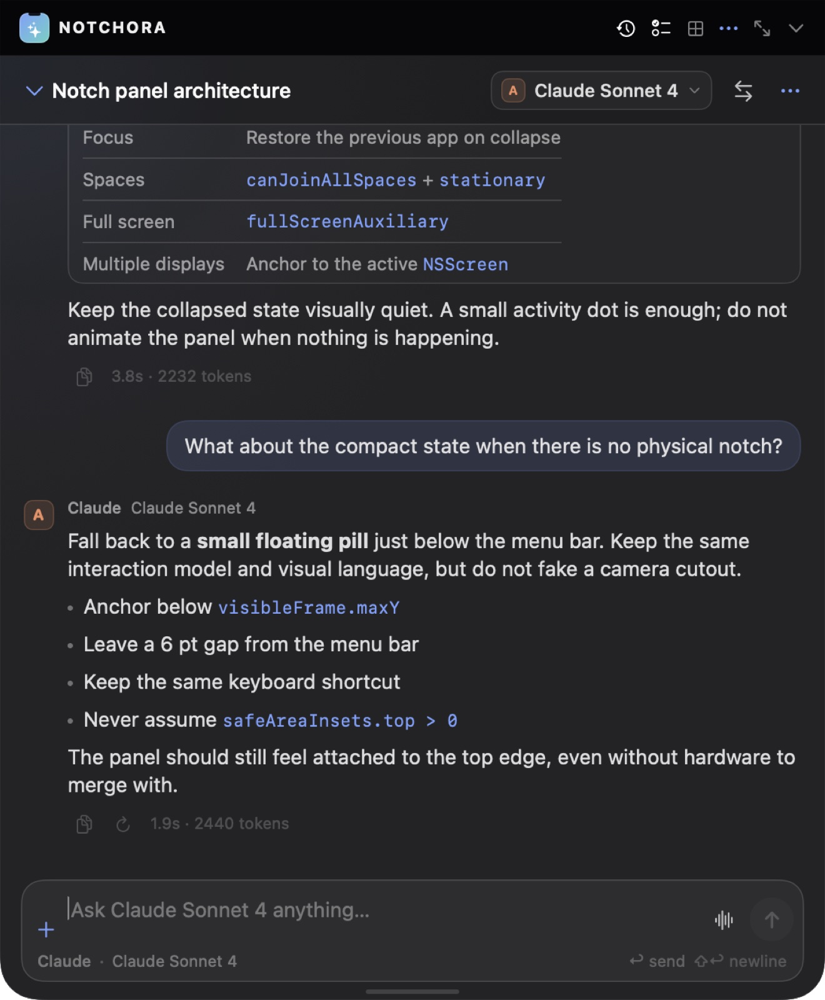
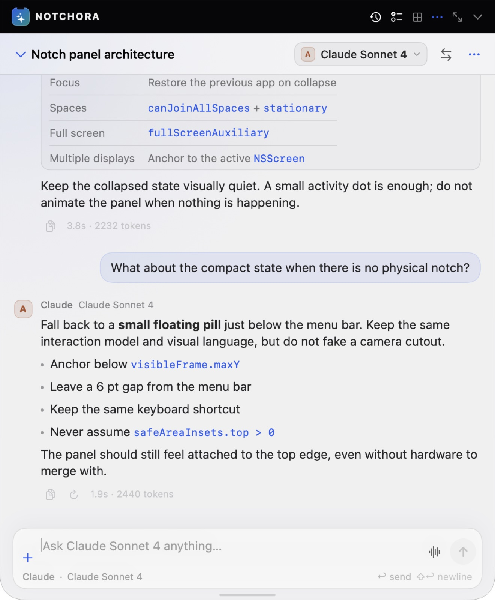
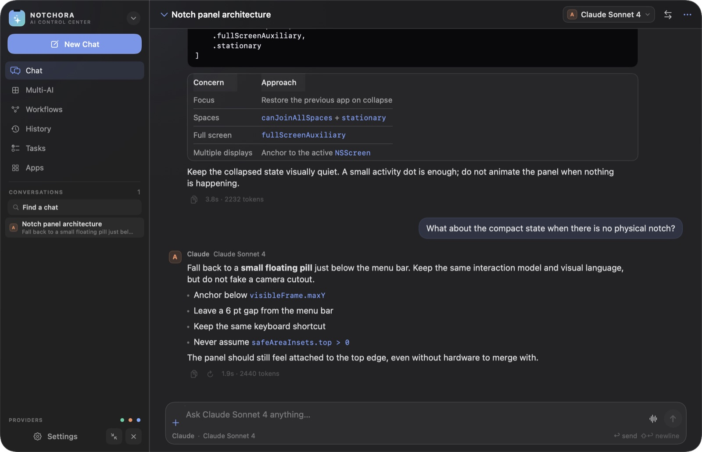
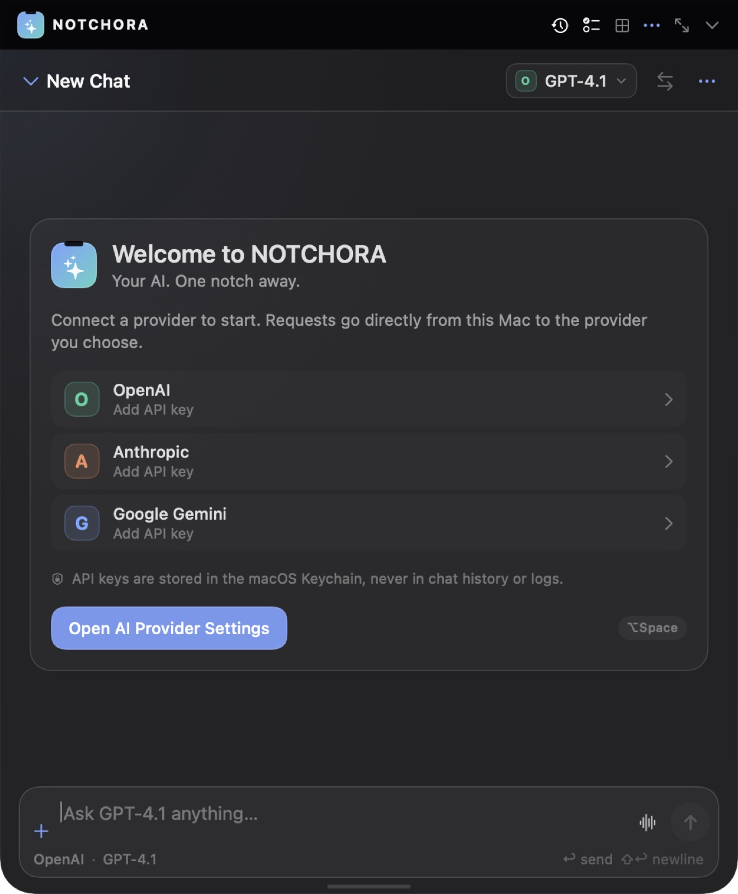
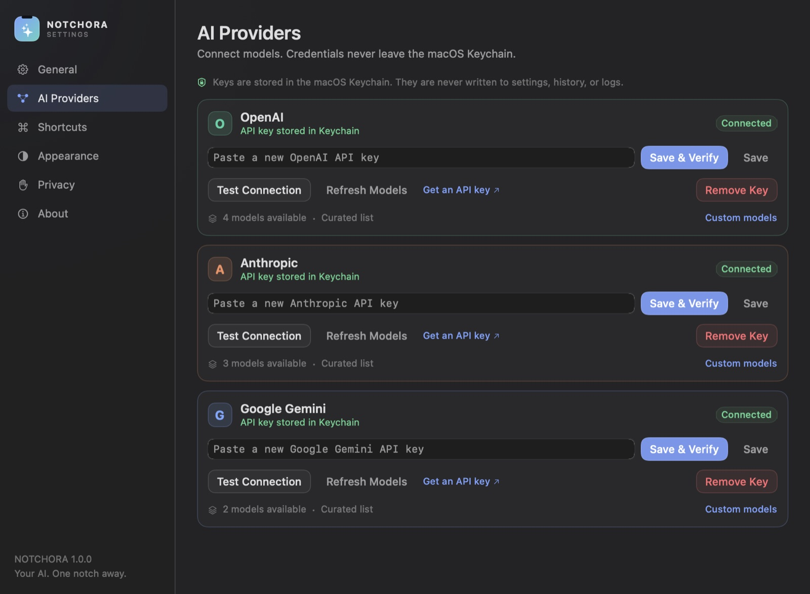
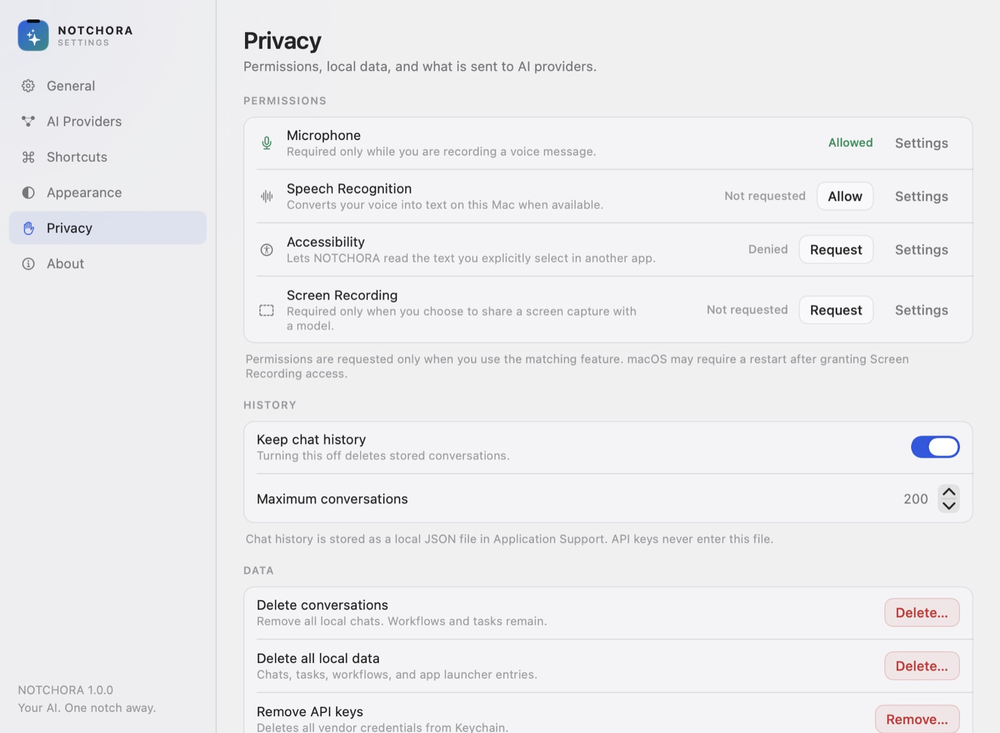

# Visual QA Report

Generated by `./Scripts/visual-qa.sh` from the debug-only `QAHarness`. The app captures its own `NSWindow.contentView`, so no Screen Recording permission is involved.

**Fixture note:** the conversations, task results, and “Connected” provider statuses in these images are debug fixtures. No network request is made and no real API key is used.

| Artifact | State |
|---|---|
| `01-compact.png` | Idle notch |
| `02-onboarding.png` | First-run provider onboarding |
| `03-chat-dark.png` | Expanded chat, dark |
| `04-chat-light.png` | Expanded chat, light |
| `05-workspace-dark.png` | Full workspace, dark |
| `06-workspace-light.png` | Full workspace, light |
| `07-history.png` | History |
| `08-tasks.png` | Tasks with running/failed/completed |
| `09-workflows.png` | Workflow presets |
| `10-multi-ai.png` | Parallel answers and comparison |
| `11-compact-active.png` | Compact with an active task |
| `12-settings-general.png` | Settings, General |
| `13-settings-providers.png` | Settings, providers |
| `14-settings-privacy.png` | Settings, privacy |
| `15-settings-light.png` | Settings, light mode |

## Selected frames

### Chat, dark



### Chat, light



### Full workspace



### Multi-AI


### Onboarding



### Tasks


### Settings





## Findings and fixes

| Finding | Resolution |
|---|---|
| Icon-only `.plain` buttons rendered white in light appearance | Switched icon-only controls to `.borderless`; rebuilt hosting view on appearance changes |
| Model picker label collapsed to an icon | Replaced the menu label with a popover listing complete model names and custom models |
| Empty onboarding content sat at the top of a tall panel | Vertically centered the empty state |
| Duplicate “No API key” notice + onboarding card | Hid the composer key notice while the empty state is visible |
| Raw Markdown (`**…**`) leaked into conversation previews | Added `PlainText` stripping for previews and search excerpts |
| Settings command could not open a window through the SwiftUI selector | Added a dedicated `SettingsWindowController` and replaced the app Settings command |
| API-key setting enum persistence could throw a property-list exception | Persist enum raw strings; covered by tests |
| Task cancellation could mutate a dictionary during iteration | Snapshot cancellation handles before iterating; regression test added |
| Workflow cancellation was not bound to the task handle | Store and cancel the structured workflow `Task` |
| Light/dark appearance could leave stale control colors | Rebuild the hosting view after appearance changes |
| UI-first-run and QA state could leak into the real app | QA uses in-memory keys and a separate state path; release build excludes the harness |

## Layout checks

- Expanded panel: 548 × 664 pt.
- Window workspace: 1120 × 722 pt.
- Compact notch: computed from physical notch width plus 92 pt, clamped to the screen.
- Settings: 900 × 660 pt content, resizable down to 780 × 560.
- Retina capture: 2× backing scale, downsampled for repository images.

## Remaining visual observations

- The top rail intentionally remains near-black in light mode, matching the hardware notch.
- The long workspace conversation auto-scrolls to the latest messages; this is expected on open.
- Settings scrolls when a page is longer than the window.
- The screenshots show a debug fixture with large headings/code to stress the Markdown renderer; real responses may be shorter.

## Reproduce

```bash
./Scripts/visual-qa.sh
open build/screenshots/qa/
```

The script returns non-zero if any expected screenshot is missing or empty, if global shortcut registration reports an error, or if the composer is not the first responder after expansion. The runtime report is written to `build/screenshots/qa/runtime-status.txt`:

```text
firstResponder: NSTextView
shortcutErrors: none
presentation: expanded
```
