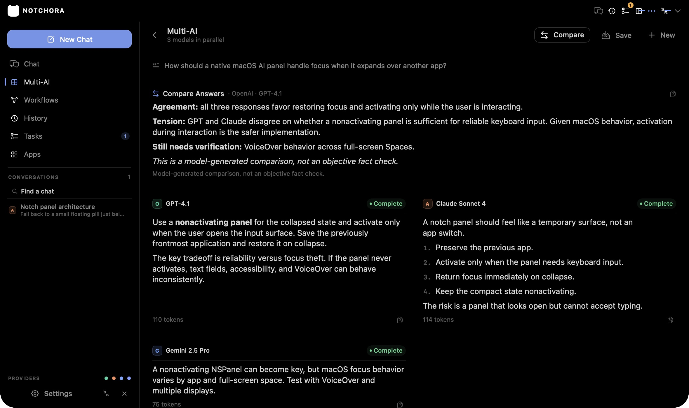
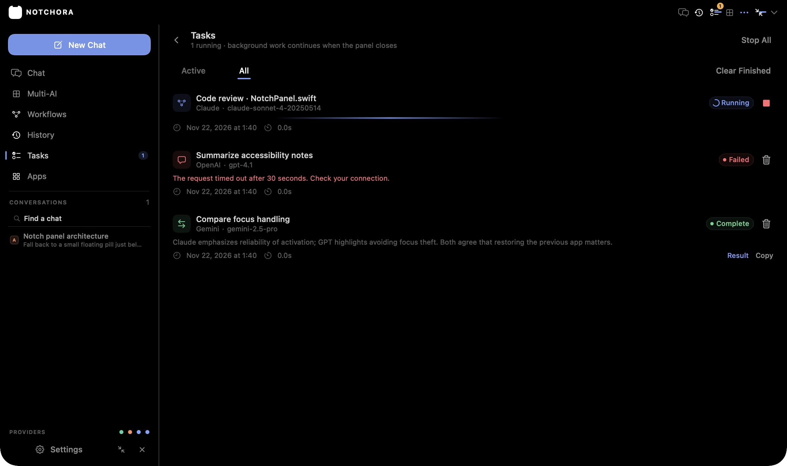

# Visual QA Report

Generated by `./Scripts/visual-qa.sh` from the debug-only `QAHarness`. The app captures its own `NSWindow.contentView`, so no Screen Recording permission is involved.

**Fixture note:** the conversations, task results, and “Connected” provider statuses in these images are debug fixtures. No network request is made and no real API key is used.

## Artifact index

| Artifact | State |
|---|---|
| `01-compact.png` | Idle compact surface |
| `02-onboarding.png` | First-run provider onboarding |
| `03-chat-dark.png` | Expanded chat, system dark |
| `04-chat-light.png` | Expanded chat, system light — surface stays black |
| `05-workspace-dark.png` | Full workspace, system dark |
| `06-workspace-light.png` | Full workspace, system light — surface stays black |
| `07-history.png` | History |
| `08-tasks.png` | Tasks with running/failed/completed |
| `09-workflows.png` | Workflow presets |
| `10-multi-ai.png` | Parallel answers and comparison |
| `11-compact-active.png` | Compact after task fixture; surface is exactly the hardware notch |
| `12-settings-general.png` | Settings, General |
| `13-settings-providers.png` | Settings, providers |
| `14-settings-privacy.png` | Settings, privacy |
| `15-settings-light.png` | Settings, system light |
| `16-expand-70ms.png` | Surface just after expansion starts |
| `17-expand-170ms.png` | Surface growing, content not yet visible |
| `18-expand-350ms.png` | Surface nearly settled, content visible |
| `19-expand-final.png` | Settled expanded surface |
| `20-collapse-80ms.png` | Collapse begins |
| `21-collapse-200ms.png` | Surface shrinking |
| `22-collapse-400ms.png` | Near-compact black shape |
| `23-collapse-final.png` | Compact surface |
| `24-model-picker.png` | In-notch model picker |
| `25-handoff.png` | In-notch Handoff |
| `26-system-prompt.png` | In-notch system prompt |
| `27-screen-capture.png` | In-notch screen capture picker |
| `28-voice.png` | In-notch voice mode |
| `29-workflow-editor.png` | In-notch workflow editor |

## Selected frames

### Chat, system dark


### Full workspace


### Multi-AI



### In-notch model picker


### Onboarding


### Tasks



### Settings


## Findings and fixes

| Finding | Resolution |
|---|---|
| Expanded UI was a separate rounded material window under the notch | Replaced with one opaque-black SwiftUI surface welded to the display edge; the workspace and settings render inside it |
| Window-frame animation and view crossfade left a transparent top band and a gray ghost | The window is now only a transparent container; the surface's own width/height animate with a spring inside it, and a stable black fill is always present |
| The growing shape was anchored top-left during animation | The surface is positioned explicitly at the container's horizontal centre and top edge; a pixel validator checks centring |
| Compact indicator appeared while a large surface was still collapsing | The compact content is hidden until the shrink is near completion; the compact surface now matches the hardware cutout exactly |
| Settings opened in a separate window | Cmd+, the app menu, and the status menu now open Settings inside the notch workspace |
| Settings content was a three-column window with material backgrounds | It is now a workspace route with flat black sections and no material or card fills |
| Model picker, Handoff, System Prompt, Screen Capture, and Workflow Editor used sheets/popovers | Replaced with in-notch overlays; no `.sheet` or model-picker popover remains |
| Native segmented controls and text fields drew gray tracks/fills | Replaced with a flat segmented selector and black text fields with a single hairline |
| Handoff target model name was clipped out of the menu label | Simplified the menu label to a single visible provider/model string |
| Workflow step and execution cards looked like extra cards | Removed step and comparison card fills/borders; content sits directly on black |
| Old light-mode icon-only `.plain` buttons rendered white | Icon-only controls use `.borderless`; the notch is now always dark independently of system appearance |
| Duplicate “No API key” notice + onboarding card | Hid the composer key notice while the empty state is visible |
| Raw Markdown (`**…**`) leaked into conversation previews | Added `PlainText` stripping for previews and search excerpts |
| Task cancellation could mutate a dictionary during iteration | Snapshot cancellation handles before iterating; regression test added |
| Workflow cancellation was not bound to the task handle | Store and cancel the structured workflow `Task` |
| UI-first-run and QA state could leak into the real app | QA uses in-memory keys, a QA UserDefaults suite, and a separate state path; release build excludes the harness |

## Shape validation

`Scripts/validate-notch-shape.swift` samples the PNG alpha and colour channels. For compact, expanded, and intermediate growth/collapse frames it verifies:

- the top edge is present and opaque black;
- the surface is horizontally centred while its width changes;
- the left surface edge is pure opaque black;
- the bottom centre is opaque;
- the two lower corners are transparent, producing rounded rather than rectangular corners.

A representative run reports:

```text
Notch shape OK: 1720×1080, surface 629...1090×0...141, opaque black, welded and centered, rounded bottom
Notch shape OK: 1720×1080, surface 257...1462×0...696, opaque black, welded and centered, rounded bottom
Notch shape OK: 370×74, surface 0...369×0...73, opaque black, welded and centered, rounded bottom
```

The white area in the preview of a mid-animation PNG is alpha-0 transparency outside the rounded surface; it is not a white window background. The black surface itself is alpha 255.

## Layout checks

- Compact surface on the test MacBook: 185 × 37 pt, exactly the measured hardware notch; no ears, chin, logo, line, or counter.
- Expanded surface: 860 × 540 pt, wider and shorter than the previous panel.
- Full workspace: 1180 × 700 pt.
- Surface top edge: exact display top edge.
- Compact bottom radius: 10 pt (matching the cutout); expanded/workspace bottom radius: 28 pt.
- Retina capture: 2× backing scale; repository images are downsampled.
- Window container is enlarged before the surface grows and trimmed after it settles, so the surface is never clipped by the window.

## Runtime checks

The harness also writes `runtime-status.txt`:

```text
firstResponder: NSTextView
shortcutErrors: none
presentation: expanded
```

## Remaining visual observations

- The notch surface is intentionally black at all times; the system light setting changes AppKit menus/controls but not the notch fill.
- The physical notch itself is hardware and cannot appear in an `NSView` self-capture; its position is matched by using the display top edge and the measured notch width.
- The screenshots show debug fixtures with large headings/code to stress the Markdown renderer; real responses may be shorter.
- The app overlays the central menu-bar area while the surface is open, by design.

## Reproduce

```bash
./Scripts/visual-qa.sh
open build/screenshots/qa/
```

The script returns non-zero if an expected screenshot is missing, if global shortcut registration reports an error, if the composer is not the first responder after expansion, or if the shape validator rejects an opaque/centred/rounded surface.
