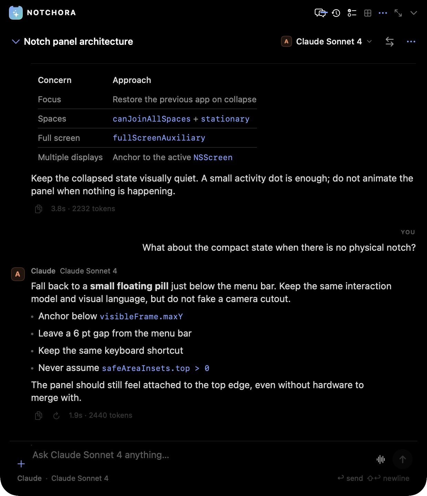
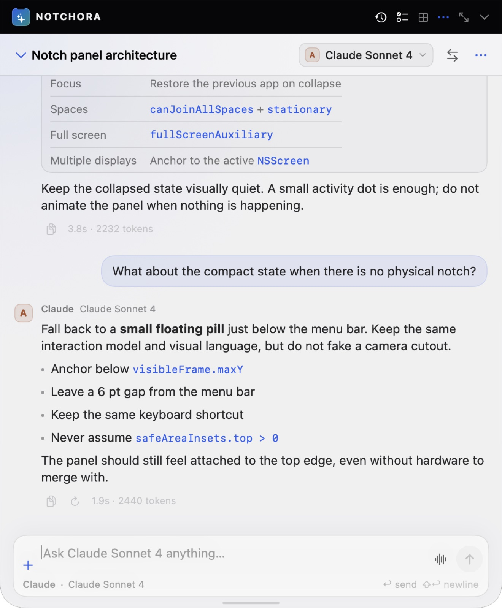
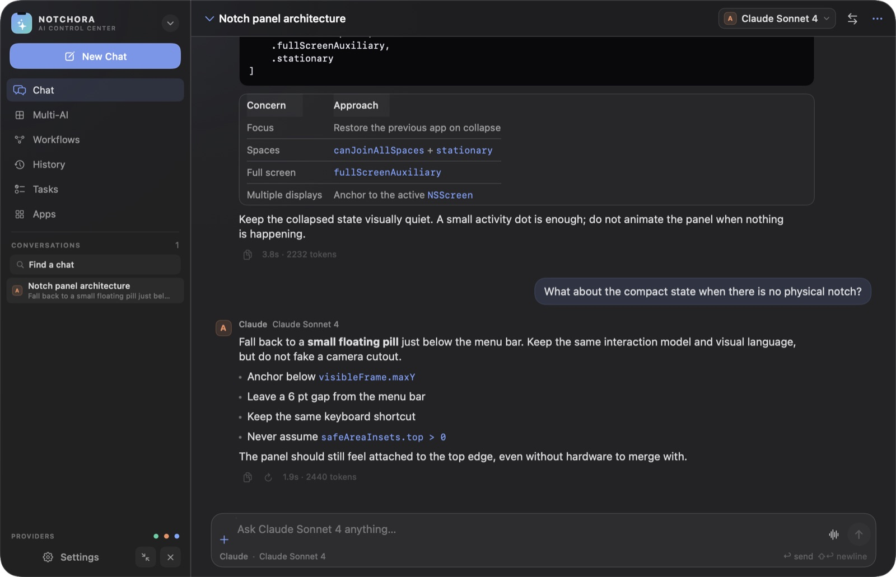
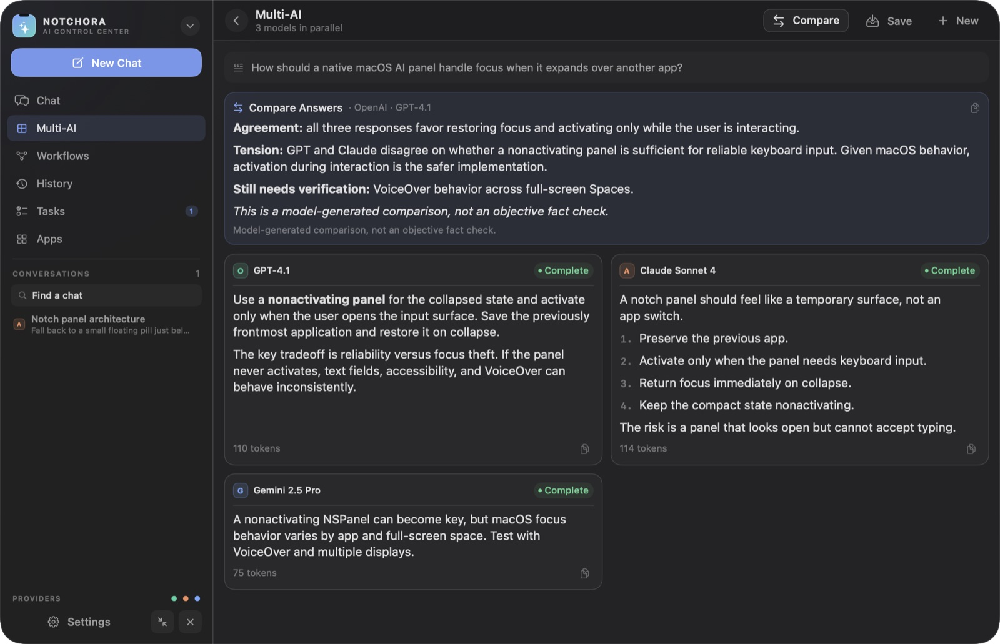
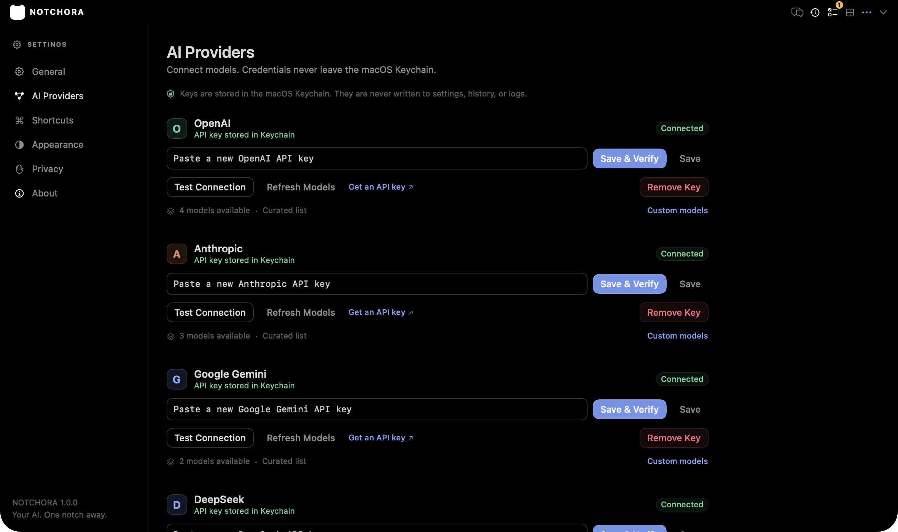
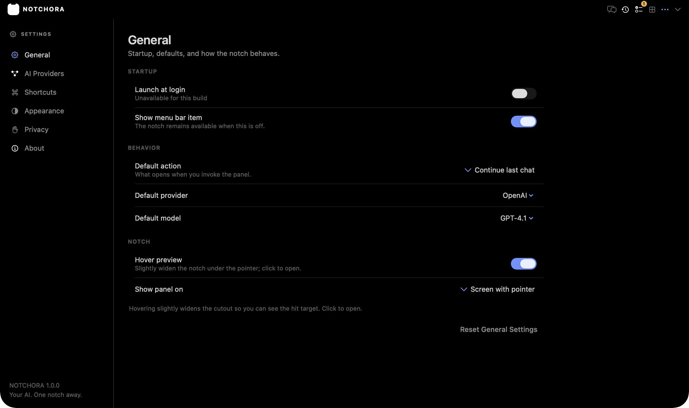
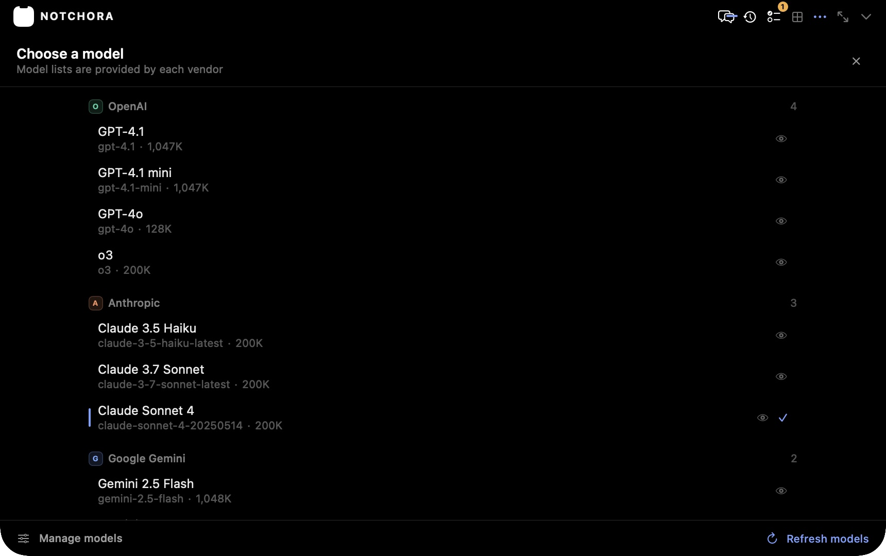
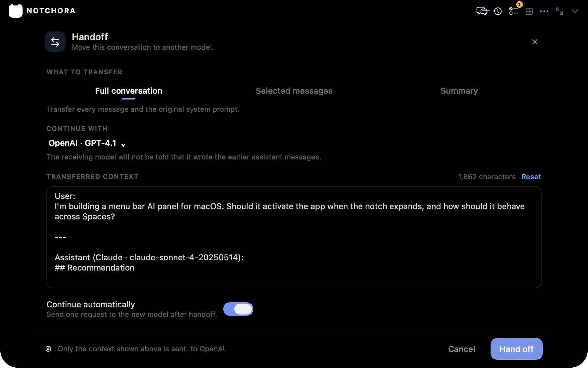
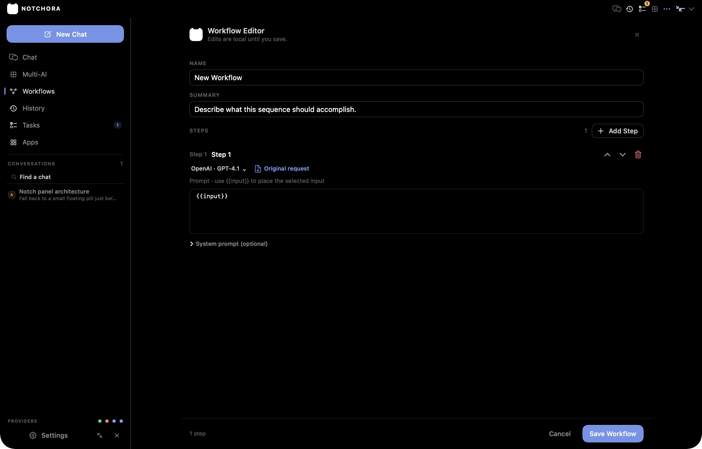

# NOTCHORA

**Your AI. One notch away.**

NOTCHORA is a native macOS AI control center that lives at the top edge of the display. It extends the MacBook notch into a compact AI surface, a focused chat panel, and a full multi-model workspace — without pretending to be a web app in a window.

Built with Swift 6, SwiftUI, AppKit, ScreenCaptureKit, AVFoundation, Speech, Keychain Services, and Swift Concurrency. No Electron, no Tauri, no Python runtime, no third-party packages.

<p align="center">
  
</p>

## Why it exists

The centrepiece is a single SwiftUI surface welded to the top edge. It does not open a floating translucent panel below the notch: its width and height animate as one opaque black form, while the content fades in after the form has started to grow. There is no material, blur, glass, border, drop shadow, or second workspace window. Settings, history, workflows, handoff, screen capture, and the model picker all live inside the same surface.

Most AI work is fragmented across browser tabs and separate desktop apps. NOTCHORA keeps the useful parts in one native surface:

- ask any connected model without leaving the current app;
- send one prompt to several models and compare the answers;
- hand a conversation from Claude to GPT without retyping context;
- bring in selected text, clipboard content, or a screen capture explicitly;
- run background tasks and workflows that keep their state;
- keep everything one gesture away with a small notch surface.

## Highlights

| Area | What is implemented |
|---|---|
| Notch experience | One continuous, opaque-black notch surface that physically grows downward and outward from the cutout; compact, expanded, and full workspace states; physical-notch detection; non-notch fallback; multi-display anchoring; Spaces/full-screen behavior; spring shape animation; reduced-motion support |
| AI providers | Real streaming integrations for OpenAI, Anthropic Claude, Google Gemini, and DeepSeek; per-provider model discovery; custom model IDs; cancellation; timeout/retry; API key validation; token usage |
| Chat | Multiple conversations; rename/delete/pin/search; Markdown; syntax highlighting; tables; copy; regenerate; stop; per-chat system prompt; local history |
| Multi-AI | Parallel independent streams; per-model cancel/retry; side-by-side results; model-generated Compare Answers with an explicit fact-checking disclaimer; save results to history |
| Handoff | Full conversation, selected messages, or an AI-generated summary; editable transferred context; target model picker; optional auto-continuation |
| Voice | Microphone permission flow; Speech framework transcription; animated level waveform; voice states; speech synthesis; interruption; auto-speak preference |
| Context | Accessibility selected-text actions; explicit clipboard actions; ScreenCaptureKit full-screen, window, and dragged-area capture; image attachment previews |
| Tasks | Pending/running/completed/failed/cancelled states; real background generation; cancel; result copy; local recovery after relaunch |
| AI apps | Installed-app discovery through `NSWorkspace`; open/switch; custom app entries; curated suggestions |
| Workflows | Sequential multi-model steps; per-step provider/model/prompt/system prompt; visual editor; run progress; results saved to history |
| Settings | Fully inside the notch surface: general, providers, shortcuts, appearance, privacy, about; persistent preferences; launch at login; custom model IDs |
| Security | API keys only in Keychain; HTTPS only; no analytics; no hidden clipboard/screen/microphone monitoring; local state with owner-only permissions |

## Screenshots

| System dark | System light |
|---|---|
|  |  |

| Full workspace | Multi-AI |
|---|---|
|  |  |

| Provider settings | System light settings |
|---|---|
|  |  |

| In-notch model picker | In-notch Handoff | In-notch workflow editor |
|---|---|---|
|  |  |  |

The notch is deliberately black in every system appearance so it merges with the hardware cutout. The screenshots come from the debug-only visual QA harness with fixture conversations and placeholder connected keys. See [TESTING.md](TESTING.md) and [QA.md](QA.md).

## Requirements

- macOS 14.0 or newer
- Apple Silicon or Intel Mac
- Xcode 16 or newer with Swift 6 (tested with Xcode 26.6 / Swift 6.3 on macOS 26.6)
- An API key for at least one provider

The app itself has no runtime dependencies.

## Quick start

```bash
git clone <repository> NOTCHORA
cd NOTCHORA
./Scripts/build-app.sh
open build/NOTCHORA.app
```

`make app` does the same thing. `make run` builds and launches.

The build is ad-hoc signed for local use. For launch at login, move `NOTCHORA.app` to `/Applications` and open it from there.

## Connect a provider

1. Press `⌥Space`, use the menu-bar item, or hover/click the cutout area. Hovering slightly widens the notch as a hit target; clicking opens. The closed state itself is exactly the hardware cutout.
2. Open **Settings → AI Providers**.
3. Paste an API key for OpenAI, Anthropic, Google Gemini, or DeepSeek.
4. Choose **Save & Verify**.
5. Use **Refresh Models** to replace the curated suggestions with the provider's current model list.

Keys are stored in the macOS Keychain under the service `com.notchora.app.credentials`. They are never placed in `UserDefaults`, chat history, or logs.

Provider key pages:

- OpenAI: <https://platform.openai.com/api-keys>
- Anthropic: <https://console.anthropic.com/settings/keys>
- Google AI Studio: <https://aistudio.google.com/app/apikey>
- DeepSeek: <https://platform.deepseek.com/api_keys>

The model list is intentionally data-driven. If a provider adds a model before NOTCHORA ships an update, refresh the list or add the exact model ID under **Custom models**.

## Permissions

NOTCHORA requests permissions only when the matching feature is used.

| Permission | Used for | Where |
|---|---|---|
| Microphone | Recording your voice during an explicit Voice Mode session | System Settings → Privacy & Security → Microphone |
| Speech Recognition | Turning recorded speech into text | Privacy & Security → Speech Recognition |
| Accessibility | Reading the text you explicitly selected in another app | Privacy & Security → Accessibility |
| Screen Recording | Capturing a screen for an explicit image attachment | Privacy & Security → Screen Recording |

macOS may require restarting NOTCHORA after granting Screen Recording. If selected text is unavailable, NOTCHORA explains the limitation and offers to use the clipboard instead. It never simulates copy keystrokes or polls the clipboard.

## Default shortcuts

| Action | Default |
|---|---|
| Open / collapse NOTCHORA | `⌥Space` |
| New Chat | `⌥N` |
| Voice Mode | `⌥V` |
| Ask Selected Text | `⌥S` |
| Multi-AI | `⌥M` |
| Hide Panel | `⌥.` |

All shortcuts can be changed in **Settings → Shortcuts**. Registration failures are reported per action. A shortcut without Command, Option, or Control is rejected so ordinary typing is never intercepted.

## Keyboard and accessibility

- Return sends from the composer; Shift+Return inserts a newline.
- Escape collapses the panel or dismisses the current overlay.
- Text can be selected and copied from messages, including code blocks.
- VoiceOver labels are provided for icon-only controls.
- Reduce Motion is respected; panel expansion also honors the in-app animation preference.
- High-contrast/system colors and native focusable controls are used throughout.

## Project layout

```text
NOTCHORA/
├── Package.swift
├── Sources/
│   ├── NotchoraCore/        # models, providers, streaming, storage, security,
│   │                        # tasks, workflows, domain logic
│   └── NotchoraApp/         # AppKit lifecycle, SwiftUI UI, services, platform APIs
├── Tests/NotchoraCoreTests/ # 58 XCTest tests
├── Scripts/                 # build, icon generation, visual QA
├── Resources/Info.plist
├── Docs/                    # screenshots and supporting documentation
├── USER_GUIDE.md
├── ARCHITECTURE.md
├── INSTALLATION.md
├── TESTING.md
├── PRIVACY.md
├── FEATURES.md
├── LIMITATIONS.md
└── QA.md
```

Open `Package.swift` in Xcode to work on the package. The executable scheme is `NOTCHORA`; the test scheme is the package test target.

## Build and test

```bash
make build   # debug build
make test    # XCTest suite
make app     # release .app bundle
make dmg     # release .app bundle + DMG
make qa      # debug visual QA: 30 screenshots, including shape-growth frames
make watch   # rebuild + relaunch on source changes while editing in Cursor/DSH
```

Direct equivalents:

```bash
swift build
swift test
./Scripts/build-app.sh
./Scripts/visual-qa.sh
```

See [USER_GUIDE.md](USER_GUIDE.md) for step-by-step usage and [TESTING.md](TESTING.md) for the full test matrix and manual QA checklist.

## Security and privacy

- No telemetry, analytics, or crash-reporting SDK.
- No proxy server. Requests go directly over HTTPS to the provider you selected.
- API keys: macOS Keychain only.
- Local state: `~/Library/Application Support/NOTCHORA/state.json`, mode `0600`.
- Clear local history and keys from **Settings → Privacy**.
- Context from other apps and model output is treated as untrusted data. NOTCHORA never executes terminal commands or arbitrary actions suggested by a model.

Read [PRIVACY.md](PRIVACY.md) for the detailed data map.

## Current status and honest limitations

This repository contains a working native app, not a mockup. The core flows compile, the app launches, and the automated visual QA harness exercises compact, expanded, workspace, chat, onboarding, history, tasks, workflows, Multi-AI, settings, model picker, handoff, system prompt, screen capture, voice, and workflow editor states. It also captures the surface at intermediate expansion/collapse frames and validates the opaque-black, welded, centered shape pixel by pixel.

Some capabilities require credentials or macOS TCC permissions that were not available in the build environment:

- live requests to OpenAI/Anthropic/Gemini/DeepSeek were not executed without user keys; request construction and SSE parsing are covered by fixture-driven tests;
- microphone/Speech, Accessibility, and Screen Recording end-to-end paths were not exercised without TCC grants;
- launch-at-login reports unavailable for an ad-hoc build outside `/Applications`;
- an XCUITest bundle is not included; UI automation is screenshot-based plus a manual checklist.

These and other limitations are documented in [LIMITATIONS.md](LIMITATIONS.md). The app surfaces missing keys, permissions, network failures, and provider errors instead of faking success.

## License

MIT © 2026 Sharunov Alexey. See [LICENSE](LICENSE).
